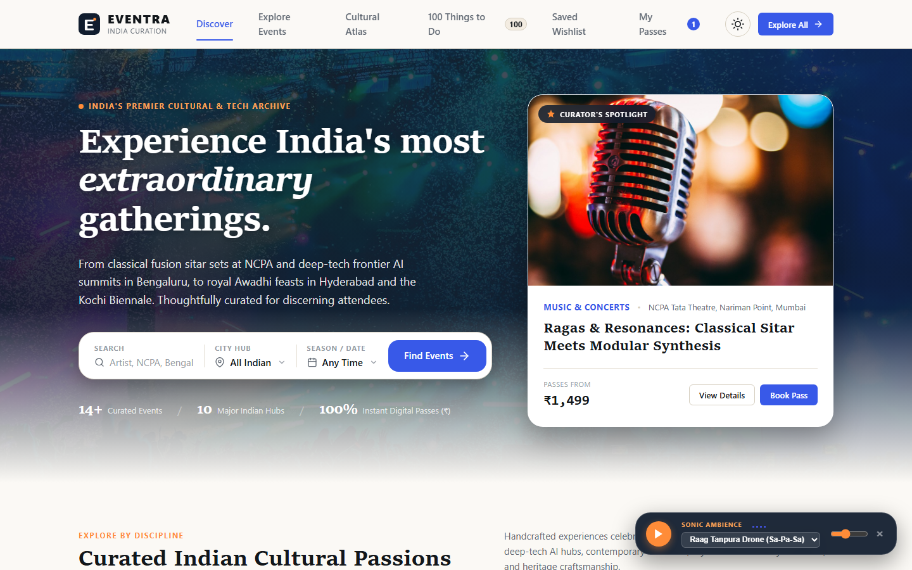
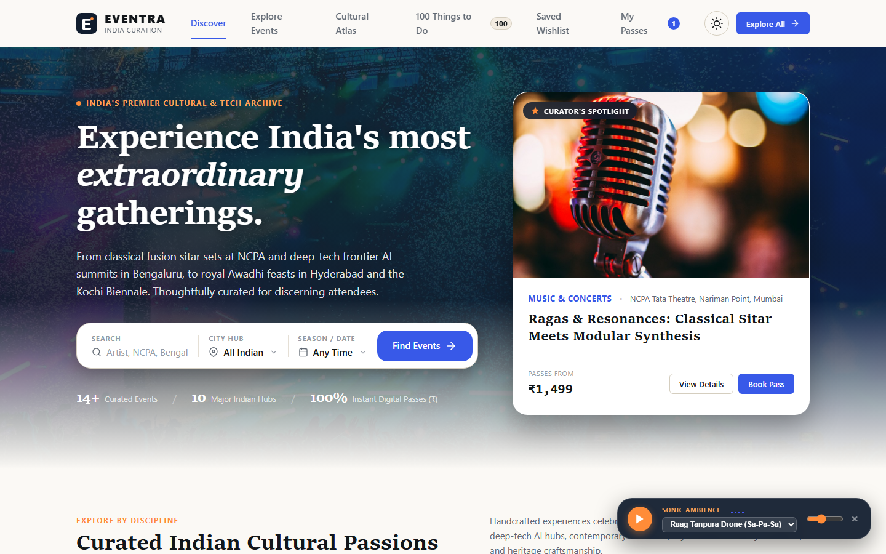
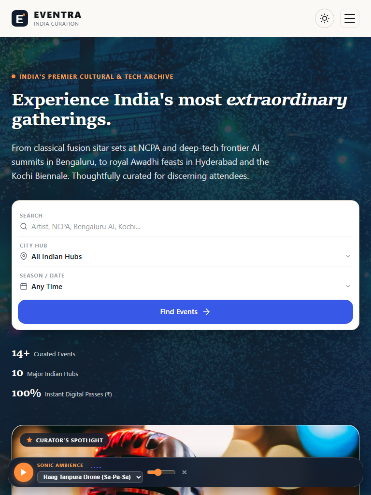
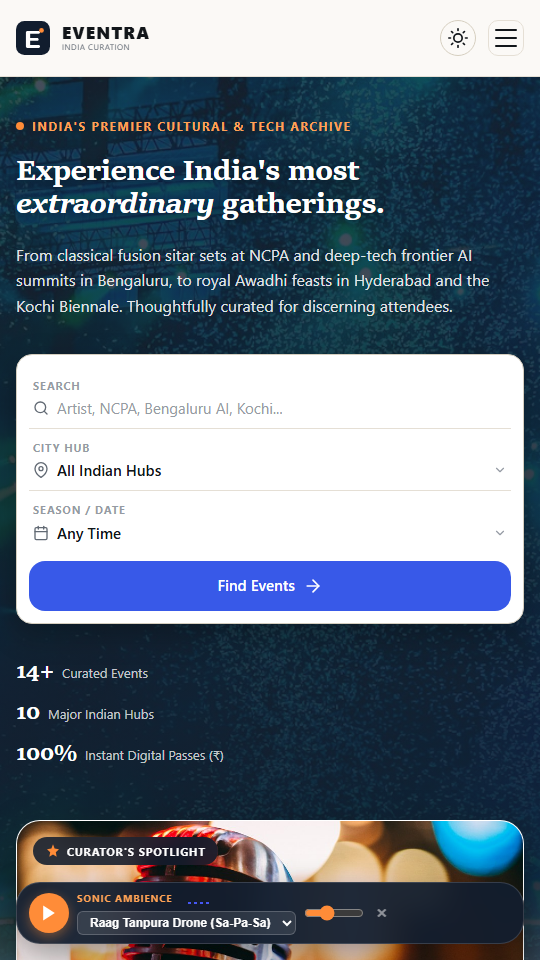

# EVENTRA INDIA (भारत)
### Premium Event Discovery, Cultural Atlas & Digital Ticketing Platform
**Tagline:** *Discover. Book. Experience.*



---

## 1. Overview & Vision

**Eventra India** is a premier cultural and technology event discovery, regional visualizer, and demo ticket-booking platform. Built with an editorial magazine aesthetic merged with consumer ticketing architecture, the platform curates extraordinary gatherings and 100 authentic experiences across the Indian subcontinent: from Hindustani classical fusion sitar sets at NCPA Mumbai and deep-tech frontier AI summits in Bengaluru, to royal Awadhi culinary feasts at Falaknuma Palace and high-altitude ultra endurance marathons in Ladakh.

### Key Highlights
- **100% Pan-India Curation:** Exclusively centered on Indian culture, tech hubs, heritage venues, and cities.
- **100 Extraordinary Things to Do in Bharat:** An authored experiential bucket list archive across 6 Indian regions and 8 cultural categories, complete with a gamified **Quest Tracker HUD**, dynamic pilgrim ranks (*Curious Seeker* to *Bharat Mahasabha Legend*), and `localStorage` persistence.
- **The Cultural Atlas of Bharat:** Interactive vector territory visualizer mapping Northern Plains, Deccan Plateau, Western Gateway, Eastern Delta, Himalayan Heights, and Central Heartlands with acoustic lineages, gastronomy, and active season gatherings.
- **Interactive Seating Architecture Visualizer:** SVG sector amphitheatre visualizer inside the booking modal allowing visual selection between Royal Box VIP suites, Central Stalls, and Upper Balcony tiers.
- **Dynamic Group Discount Engine:** Automatic privileges applied at checkout (5% *Cultural Circle* discount for 3–4 passes; 10% *Royal Syndicate* discount for 5–6 passes).
- **Procedural Acoustic Soundscape Synthesizer:** Pure client-side Web Audio API atmosphere engine featuring *Raag Tanpura Drone* (Sa-Pa-Sa harmonic shimmer with Javari bridge modulation), *Himalayan Singing Bowl* (432Hz partials with natural resonance), *Goa Arabian Sea Waves* (pink-noise tidal wave wash), and *DeepTech Modular Pulse*, with real-time canvas spectrum visualization.
- **Day & Night Theme Switcher:** Instant toggle between *Royal Sandalwood Ivory* (Day) and *Midnight Silk* (Night), persisted via `localStorage`.
- **Authentic Photographic Identity:** Zero synthetic or neon artwork; every card, hero banner, and showcase features authentic high-resolution local photography.
- **Zero External Dependencies:** Built with pure semantic HTML5, CSS3, and modern Vanilla JavaScript (no CDNs, no remote fonts, no third-party JavaScript libraries).
- **Interactive INR (₹) Ticketing Engine:** Complete 3-step booking flow, multi-tier pricing, dynamic subtotal + platform fee calculations, and persistent digital passes.
- **Canvas QR & Barcode Generator:** Client-side procedural QR matrix and simulated barcode rendering for instant printable digital passes.

---

## 2. Design System & Theming

Eventra implements an editorial design system engineered with CSS custom properties.

| Design Token | Day Mode (Royal Sandalwood) | Night Mode (Midnight Silk) | Role |
| :--- | :--- | :--- | :--- |
| `--bg-primary` | `#FBF9F5` (Warm Sandalwood) | `#0D1117` (Deep Charcoal) | Canvas background |
| `--bg-surface` | `#FFFFFF` (Pure White) | `#161B22` (Surface Silk) | Cards, modals, drawers |
| `--text-primary` | `#12161A` (Editorial Ink) | `#F0F6FC` (Luminous Ivory) | Primary typography |
| `--text-secondary`| `#626A74` (Warm Graphite) | `#8B949E` (Muted Steel) | Metadata, descriptions |
| `--accent-cobalt`| `#3859E8` (Electric Cobalt) | `#5875FF` (Vibrant Cobalt) | Primary actions & buttons |
| `--accent-coral` | `#FF8C38` (Saffron Amber) | `#FFA255` (Glowing Amber) | Badges, quest tracker, highlights |
| `--border-light` | `#E5DFD5` (Soft Ivory Border)| `#30363D` (Subtle Grid Border)| Separators & card edges |

### Typography Stack
- **Editorial Serif:** `Charter, "Sitka Text", Cambria, Georgia, serif` for commanding headlines and event titles.
- **Functional Sans-Serif:** `system-ui, -apple-system, BlinkMacSystemFont, "Segoe UI", Roboto, sans-serif` for high-legibility UI controls.
- **Monospace Code:** `ui-monospace, "Cascadia Code", Menlo, monospace` for PNR references and ticket codes.

---

## 3. The 100 Things to Do in Bharat Archive

An authored cultural odyssey spanning 100 quintessential experiences across the subcontinent:

- **Spiritual & Chants:** Assi Ghat dawn bajra boat recitals, Golden Temple langar service, Parmarth Niketan Ganga aarti, Hemis sacred cham dances.
- **Palaces & UNESCO Heritage:** Amber Palace midnight astronomy, Thanjavur shadowless Vimana, Khajuraho temples, Hampi stone chariot.
- **Living Crafts & Heritage:** Kanchipuram mulberry silk looms, Bishnupur terracotta reliefs, Varanasi Zari weavers, Jaipur blue pottery.
- **Coastal & Waters:** Goa Latin Quarter Fontainhas walking salon, Kerala backwaters kettuvallam, Bandra-Worli midnight ultra marathon, Marine Drive promenade.
- **Himalayan Heights:** Hanle Dark Sky Reserve stargazing, Pangong Tso azure waters, Spiti Valley Key Gompa, Valley of Flowers.
- **Festivals & Music:** NCPA sitar and modular synthesis, Kochi-Muziris Biennale, Jodhpur RIFF folk festival, Tansen Samaroh.
- **Royal Gastronomy:** Falaknuma royal Nizam banquet, Lucknow Awadhi dum pukht, Kolkata College Street Coffee House adda, Sarafa Bazaar midnight food walk.
- **Frontier Tech & Modern:** Bengaluru DeepTech & AI conclave, Cyberabad quantum computing summit, T-Hub innovation showcase.

---

## 4. Curated Indian Event Calendar (2026–2027)

| Event Name | Hub / City | Discipline | Date | Starting Price |
| :--- | :--- | :--- | :--- | :--- |
| **Ragas & Resonances: Classical Sitar Meets Modular Synthesis** | NCPA Tata Theatre, Mumbai | Music & Concerts | Nov 13, 2026 | ₹1,499 |
| **Bengaluru DeepTech & Frontier AI Nexus 2026** | BIEC, Bengaluru | Technology | Nov 26, 2026 | ₹2,499 |
| **Kochi-Muziris Contemporary Art Biennale 2026** | Fort Kochi Waterfront, Kochi | Art & Culture | Dec 11, 2026 | ₹499 |
| **Dastarkhwan: Royal Awadhi & Dum Pukht Gastronomy** | Taj Falaknuma Palace, Hyderabad | Food & Drink | Dec 19, 2026 | ₹3,200 |
| **Mumbai Midnight Coastal Ultra Marathon & Expo** | Bandra-Worli Sea Link, Mumbai | Sports | Dec 31, 2026 | ₹1,200 |
| **Jaipur Virasat: Royal Heritage Handloom & Craft Biennale** | City Palace, Jaipur | Heritage & Craft | Jan 15, 2027 | ₹650 |
| **Goa Sunwave: Coastal Electronic & Modular Beach Festival** | Vagator Cliffs, Goa | Music & Concerts | Jan 22, 2027 | ₹2,899 |
| **Rangmanch: National Contemporary Theatre & Cinema Conclave**| Kamani Auditorium, Delhi NCR | Art & Culture | Feb 06, 2027 | ₹799 |
| **Cyberabad Cloud & Quantum Computing Conclave** | HITEC City, Hyderabad | Technology | Feb 18, 2027 | ₹2,199 |
| **Deccan Harvest: Artisanal Wine & Farm-to-Table Fest** | Sula Vineyards, Nashik (Mumbai) | Food & Drink | Feb 27, 2027 | ₹1,850 |
| **Prana & Sound: International Himalayan Meditation & Yoga** | Parmarth Niketan, Rishikesh | Sports & Wellness | Mar 14, 2027 | ₹1,650 |
| **Calcutta Reverie: Literature, Jazz & Independent Arts** | Victoria Memorial, Kolkata | Art & Culture | Mar 27, 2027 | ₹550 |
| **Ganga Dhwani: Ancient Acoustic Ragas & Boat Recitals** | Assi Ghat & Bajra, Varanasi | Music & Concerts | Apr 10, 2027 | ₹1,100 |
| **Trans-Himalayan Ultra Trail & High-Altitude Gravel Rally** | Khardung La Pass, Ladakh | Sports | May 02, 2027 | ₹3,500 |

---

## 5. Application Architecture & File Structure

```
eventra/
├── index.html                   # Semantic markup, SVG sprite definitions, Atlas map & accessible modals
├── style.css                    # Complete design system, Atlas visualizer, 100 Things grid & responsive tokens
├── script.js                    # State store, Atlas inspector, Quest tracker HUD, Audio synthesizer, Booking engine
├── bharat100Data.js             # Standalone universal archive of 100 curated Indian experiences
├── test-qa-suite.js             # Automated 100% test verification suite
├── IMAGE_CREDITS.md             # Attribution manifest for all licensed photographs
├── README.md                    # Technical specification & documentation
├── .gitignore                   # Ignore OS & node files
└── assets/
    ├── favicon.svg              # Local SVG brand monogram
    ├── images/                  # 22 local high-resolution Indian event photographs
    │   ├── hero-india-festival.jpg
    │   ├── showcase-palace-night.jpg
    │   ├── cat-music-in.jpg ... cat-heritage-in.jpg
    │   └── event-ragas-modular.jpg ... event-ladakh-ultra.jpg
    └── screenshots/             # Verified viewport captures
        ├── desktop-1440.png
        ├── dark-mode-1440.png
        ├── tablet-768.png
        ├── mobile-390.png
        ├── atlas-view.png
        └── bucket-list-view.png
```

---

## 6. Screenshots & Visual Verification

### Desktop Light Mode (1440 × 900)


### Desktop Dark Mode (Midnight Silk)


### Tablet View (768 × 1024)


### Mobile View (540 × 960)


---

## 7. Local Setup & Testing

### Running the Website Locally
Because Eventra uses standard web technologies with zero external dependencies, no build steps or package installations are required.

Option 1: Using any local static server:
```bash
# Using Node.js built-in npx
npx serve -l 8080

# Or Python 3
python -m http.server 8080
```
Open `http://localhost:8080` in any modern web browser.

Option 2: Direct browser launch:
Double-click `index.html` or open `file:///path/to/eventra/index.html` directly.

### Running the Automated QA Test Suite
```bash
node test-qa-suite.js
```
Output:
```
--- EVENTRA INDIA FUNCTIONAL QA TEST SUITE ---
[HTML] PASS - Semantic <header> landmark
[HTML] PASS - Semantic <main> landmark
[HTML] PASS - Semantic <footer> landmark
[HTML] PASS - Inline SVG icon definitions (zero external CDN fonts/icons)
[HTML] PASS - Theme toggle button with Royal Sandalwood & Midnight Silk accessibility labels
[HTML] PASS - Top marquee notice bar removed per user specification
[HTML] PASS - Cultural Atlas section with interactive SVG map & inspector
[HTML] PASS - 100 Things to Do in Bharat section with Quest Tracker HUD
[HTML] PASS - Venue seating architecture SVG visualizer card in booking modal
[HTML] PASS - Dynamic Group Discount line (Cultural Circle & Royal Syndicate)
[HTML] PASS - Acoustic Atmosphere Synthesizer dock with Web Audio visualizer
[HTML] PASS - Curator spotlight card with Indian event
[HTML] PASS - Editorial banner for Bengaluru DeepTech
[HTML] PASS - Modal dialog: Event Details
[HTML] PASS - Modal dialog: 3-Step ₹ INR Booking Flow
[HTML] PASS - Modal dialog: Printable Pass with Canvas QR
[HTML] PASS - Wishlist view section
[HTML] PASS - My Tickets view section
[HTML] PASS - Philosophy section
[DATA] PASS - Successfully extracted 14 curated Indian experiences
[DATA] PASS - All 14 events verified with valid Indian cities, ₹ INR tiers, and local photographic assets.
[BHARAT-100] PASS - Exactly 100 authentic Indian experiences verified in dataset
[BHARAT-100] PASS - All 100 items verified across 6 Indian regions & 8 cultural categories
[FILTER] PASS - Category filter "Technology": 2 events found (Bengaluru, Cyberabad)
[FILTER] PASS - City filter "Mumbai": 3 events found (NCPA Sitar, Midnight Ultra, Sula Wine)
[FILTER] PASS - Price filter "Under ₹1000": 4 events found
[SORT] PASS - Price Low-to-High: cheapest is "Kochi-Muziris Contemporary Art Biennale 2026" at ₹499
[SORT] PASS - Date Soonest: earliest is "Ragas & Resonances: Classical Sitar Meets Modular Synthesis" on 2026-11-13
[QR] PASS - Procedural QR finder patterns generated: 1111111
[CSS] PASS - Token "--bg-primary: #FBF9F5;" present
[CSS] PASS - Token "--accent-cobalt: #3859E8;" present
[CSS] PASS - Token "--accent-coral: #FF8C38;" present
[CSS] PASS - Token "[data-theme="dark"]" present
[CSS] PASS - Token "@media print" present
[CSS] PASS - Token "@media (max-width: 1024px)" present
[CSS] PASS - Token "@media (max-width: 768px)" present
[CSS] PASS - Token "@media (max-width: 640px)" present
--------------------------------------------------
ALL QA UNIT AND INTEGRATION CHECKS PASSED (100%)
```

---

## 8. Git Commit & Deployment (GitHub Pages)

Eventra is completely static and pre-configured for instant zero-configuration deployment to **GitHub Pages**:

```bash
git add .
git commit -m "feat: 100 Things to Do in Bharat, Cultural Atlas, Seating Visualizer & Acoustic Synthesizer"
git push origin main
```

---

## 9. License & Photography Attribution

- Source code is released under the **MIT License**.
- Event and venue photographs are sourced locally from **Unsplash** under the Unsplash Open License. Complete photographer credits, venue descriptions, and image mappings are documented in [`IMAGE_CREDITS.md`](IMAGE_CREDITS.md).
- *Disclaimer:* Eventra India is a portfolio demonstration product. All event dates, ticket passes, QR codes, and PNR references are simulated.
